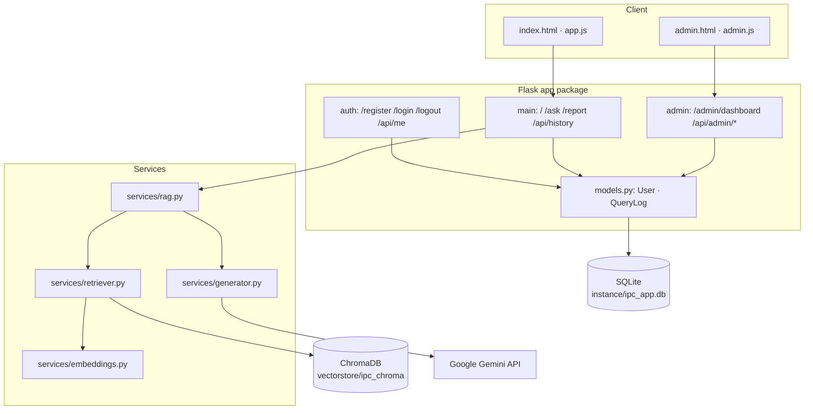

# ⚖️ AI Lawyer — IPC Assistant

A retrieval-augmented generation (RAG) pipeline that answers natural-language
questions about the **Indian Penal Code (IPC)**, with user accounts, role-based
access control, and persistent query logging.

Answers are grounded in retrieved IPC sections, so every response cites
specific section numbers — cutting down hallucination and making the system
**auditable**.

---

## Features

| Feature | Details |
|---|---|
| **RAG Q&A** | ChromaDB retrieval (top-3 IPC sections) → Gemini 2.5 Flash Lite grounded answer |
| **Authentication** | Session login with hashed passwords (`Flask-Login` + `werkzeug`) |
| **RBAC** | `admin` and `user` roles; admin-only dashboard and APIs |
| **Query logging** | Every request persisted with prompt, response, citations, latency, status, error |
| **User history** | Paginated personal query history (`/api/history`) |
| **Admin dashboard** | System metrics, user management, system-wide logs |
| **PDF report** | Export your successful queries as a PDF transcript |

---

## Architecture



**Request flow for one question**

1. `POST /ask` (login required) validates the query.
2. `services/rag.answer_ipc_query()` embeds the query and retrieves the top-3
   IPC sections from ChromaDB.
3. The sections are formatted into the prompt template and sent to Gemini.
4. The answer plus citation payload is returned and written to `QueryLog`
   together with latency and status (`SUCCESS` / `FAILED`).

---

## Project structure

```
.
├── app/
│   ├── __init__.py          # create_app() factory, db, login manager
│   ├── models.py            # User, QueryLog
│   ├── auth/                # register/login/logout/api-me + @admin_required
│   ├── main/                # chat page, /ask, /report, /api/history
│   ├── admin/               # dashboard page + admin management APIs
│   ├── services/            # embeddings, retriever, generator, RAG, PDF
│   ├── templates/           # base, index, login, register, admin
│   └── static/              # app.js, admin.js, style.css
├── data/ipc.json            # 575 IPC sections (source dataset)
├── instance/                # SQLite database (gitignored, created at runtime)
├── notebooks/evaluation.ipynb
├── scripts/
│   ├── build_index.py       # build the Chroma index
│   ├── init_db.py           # create tables + seed admin
│   └── verify_rbac.py       # end-to-end RBAC/logging verification
├── requirements.txt
├── render.yaml
└── wsgi.py
```

---

## Tech stack

| Layer | Technology |
|---|---|
| Backend | Flask 3, Gunicorn |
| Auth | Flask-Login, Werkzeug password hashing |
| Persistence | Flask-SQLAlchemy + SQLite |
| RAG orchestration | LangChain 0.3 |
| Vector store | ChromaDB (persistent, HNSW) |
| Embeddings | `sentence-transformers/all-MiniLM-L6-v2` (384-dim) |
| Generation | Google Gemini 2.5 Flash Lite |
| Reporting | ReportLab |
| Frontend | Vanilla HTML/CSS/JS |
| Deploy | Render (`render.yaml`) |

---

## Quickstart

```bash
git clone https://github.com/Avalanche-ag/legal-advisor-project.git
cd legal-advisor-project

python -m venv venv && source venv/bin/activate
pip install -r requirements.txt

cp .env.example .env            # add GEMINI_API_KEY and SECRET_KEY

python scripts/build_index.py   # builds vectorstore/ipc_chroma (one-time)
python scripts/init_db.py       # creates instance/ipc_app.db + admin user

flask --app wsgi run --port 5050
```

Open <http://127.0.0.1:5050>, register a user, and ask a question.

Default admin (override with `ADMIN_EMAIL` / `ADMIN_USERNAME` / `ADMIN_PASSWORD`):

```
email:    admin@local.dev
password: admin12345
```

> Change these credentials before deploying publicly — `.env.example`
> documents all three variables.

---

## API

| Method | Path | Access | Purpose |
|---|---|---|---|
| `GET` | `/` | public | Chat page |
| `POST` | `/ask` | user | Ask a question (logged) |
| `GET` | `/report` | user | PDF of your successful queries |
| `GET` | `/api/history` | user | Paginated personal history |
| `POST` | `/register` | public | Create a standard user |
| `POST` | `/login` | public | Start a session |
| `GET` | `/logout` | user | End the session |
| `GET` | `/api/me` | user | Current profile |
| `GET` | `/admin/dashboard` | admin | Admin UI |
| `GET` | `/api/admin/users` | admin | All users + query counts |
| `PATCH` | `/api/admin/users/<id>/role` | admin | Promote/demote |
| `PATCH` | `/api/admin/users/<id>/toggle-status` | admin | Activate/deactivate |
| `GET` | `/api/admin/logs` | admin | System logs (`?status=`, `?sort=latency`) |
| `GET` | `/api/admin/stats` | admin | Totals, success rate, avg latency |

Unauthenticated API calls return **401 JSON**; non-admin calls to admin routes
return **403**.

---

## Data model

`instance/ipc_app.db` holds two tables:

| Table | Key columns |
|---|---|
| `user` | `id`, `email` (unique), `username` (unique), `password_hash`, `role`, `is_active`, `created_at` |
| `query_log` | `id`, `user_id` → `user.id` (cascade), `query_text`, `response_text`, `retrieved_sections` (JSON), `status`, `error_message`, `latency_ms`, `created_at` |

The vector store is a separate ChromaDB SQLite database at
`vectorstore/ipc_chroma/` (575 embeddings, one per IPC section).

---

## Deployment (Render)

`render.yaml` is preconfigured:

```yaml
buildCommand:    pip install -r requirements.txt
preDeployCommand: python scripts/build_index.py && python scripts/init_db.py
startCommand:    gunicorn wsgi:app --timeout 120
```

Set these environment variables in the Render dashboard:
`GEMINI_API_KEY`, `SECRET_KEY` (auto-generated), `ADMIN_EMAIL`, `ADMIN_PASSWORD`.

> **Note:** Render's free tier provides ephemeral disk and 512 MB RAM. The
> `torch` + `sentence-transformers` stack needs roughly 600 MB, so the free
> instance can exceed its memory limit on the first request. Use a paid
> instance (2 GB) or a platform with more RAM for the retrieval layer.

---

## Known limitations

- **Ephemeral SQLite on free hosting** — `instance/ipc_app.db` is recreated on
  each deploy, so users and logs do not survive a redeploy.
- **Single-process transcript assumptions** — with multiple Gunicorn workers,
  each worker has its own SQLite connection but the database itself is shared;
  avoid SQLite on a network filesystem.
- **IPC-only corpus** — CrPC, Evidence Act and other Bare Acts are not indexed.
- **No rate limiting** — an authenticated user can exhaust the Gemini quota.
- **No password reset / email verification** flows yet.

---

## Roadmap

- [ ] Fine-tuned legal SLM as the primary provider (Gemini stays as fallback)
- [ ] PostgreSQL + Alembic migrations for durable, multi-worker deployments
- [ ] Expand the corpus (BNS, BNSS, BSA, landmark judgments)
- [ ] Rate limiting and audit export
