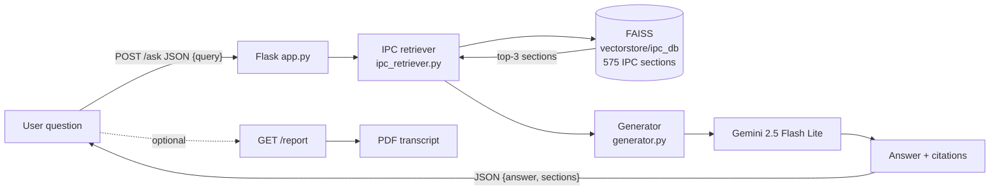

# ⚖️ AI Lawyer — IPC Assistant

A retrieval-augmented generation (RAG) pipeline that answers natural-language
questions about the **Indian Penal Code (IPC)**. The model is constrained to
the retrieved IPC sections, so every answer cites specific sections — cutting
down on hallucination and making the system **auditable**.

Built as a single, linear pipeline on purpose: no multi-agent framework, no
tool-use runtime — just retrieve → generate, with a provider-agnostic
generator that can later fall back from a fine-tuned model to the Gemini API.

---

## How it works



1. User submits a question through the Flask `/ask` endpoint.
2. `ipc_retriever.py` runs a similarity search against the FAISS index built
   from `data/ipc.json` (575 IPC sections, embedded with
   `sentence-transformers/all-MiniLM-L6-v2`).
3. `rag_pipeline.py` formats the retrieved sections as context and calls
   `generator.generate(...)`.
4. `generator.py` calls Gemini via the Google Generative AI API and returns
   a grounded answer.
5. The Flask route returns `{answer, sections[]}`; the frontend renders the
   answer plus per-section citation cards.

---

## Tech Stack

| Layer | Technology |
|---|---|
| Backend | Flask + Gunicorn |
| RAG Orchestration | LangChain 0.3.x |
| Vector Store | FAISS (flat L2 index) |
| Embeddings | `sentence-transformers/all-MiniLM-L6-v2` (384-dim) |
| Generation | Google Gemini 2.5 Flash Lite (free-tier API) |
| Reporting | ReportLab (PDF download endpoint) |
| Frontend | Vanilla HTML + CSS + JavaScript (no framework) |
| Deploy | Render (free web service, `render.yaml`) |

---

## Project structure

```
.
├── app.py                  # Flask routes: / , /ask , /report
├── wsgi.py                 # gunicorn entry
├── rag_pipeline.py         # IPC QA prompt + answer_ipc_query + PDF report
├── generator.py            # provider-agnostic generate() with fallback
├── ipc_retriever.py        # retrieve_ipc_sections(query, k=3)
├── ipc_index_builder.py    # builds FAISS index from data/ipc.json
├── vector_database.py      # lazy embedding-model singleton
├── data/ipc.json           # 575 IPC sections
├── templates/index.html    # chat page
├── static/style.css        # glassmorphism dark theme
├── static/app.js           # fetch /ask, render Q&A + citations
├── requirements.txt        # pinned dependencies
├── .env.example            # GEMINI_API_KEY + reserved fine-tuned slots
└── render.yaml             # one-click Render deploy
```

---

## Quickstart

```bash
cp .env.example .env         # paste your GEMINI_API_KEY (from aistudio.google.com/apikey)
python -m venv venv && source venv/bin/activate
pip install -r requirements.txt
python ipc_index_builder.py   # builds vectorstore/ipc_db/ (one-time, ~10s)
flask --app app run            # open http://127.0.0.1:5000
```

Sample questions to verify:

| Question | Expected sections |
|---|---|
| `punishment for theft` | §378, §379 |
| `punishment for murder` | §302 |
| `punishment for cheating` | §417, §418 |

---

## Deployment

The app is configured for one-click deploy on Render (free tier):

1. Push this repo to GitHub.
2. Go to https://render.com/deploy and paste the repo URL.
3. Render reads `render.yaml` and asks for the `GEMINI_API_KEY` secret.
4. The `preDeployCommand` rebuilds the FAISS index automatically on each deploy.

---

## Known limitations

- **No persistent conversation store.** The Flask app keeps the last 50 turns
  in module-level lists. On restart or with multiple gunicorn workers, the
  transcript is lost.
- **No authentication.** Anyone with the URL can use the app and hit the
  Gemini quota.
- **IPC-only knowledge base.** Other Indian Bare Acts (CrPC, Evidence Act,
  etc.) are not indexed yet.
- **No re-ranking or score thresholds.** Retrieval uses plain similarity
  search with k=3.
- **No tests.** A smoke test for retrieval would be a good first contribution.

---

## Roadmap

- [ ] **Fine-tuned SLM as primary model.** Fine-tune a Qwen2.5-3B-Instruct
  model on Indian Bare Acts + question/section pairs. Slot its factory into
  `generator.PROVIDERS` ahead of Gemini — the rest of the pipeline stays
  unchanged.
- [ ] **Persistent conversation store.** Replace the in-memory lists with
  Flask sessions or SQLite.
- [ ] **Expand the corpus.** Add CrPC, IEA, and landmark judgments to the
  FAISS index.
- [ ] **Test suite.** `pytest` smoke tests for retrieval, generation, and
  the `/ask` route.

---

## Acknowledgements

- IPC section dataset adapted from open Indian Penal Code data.
- Frontend design uses Google Poppins + Font Awesome via CDN.